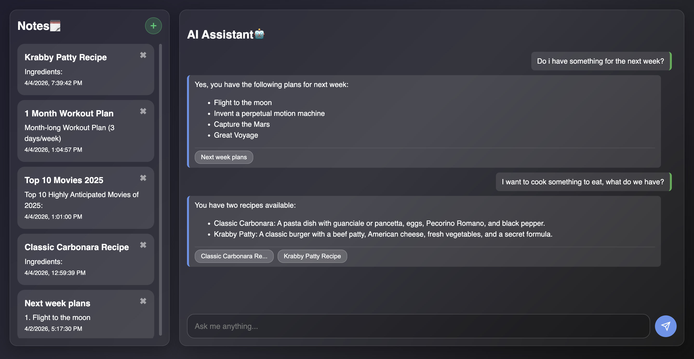
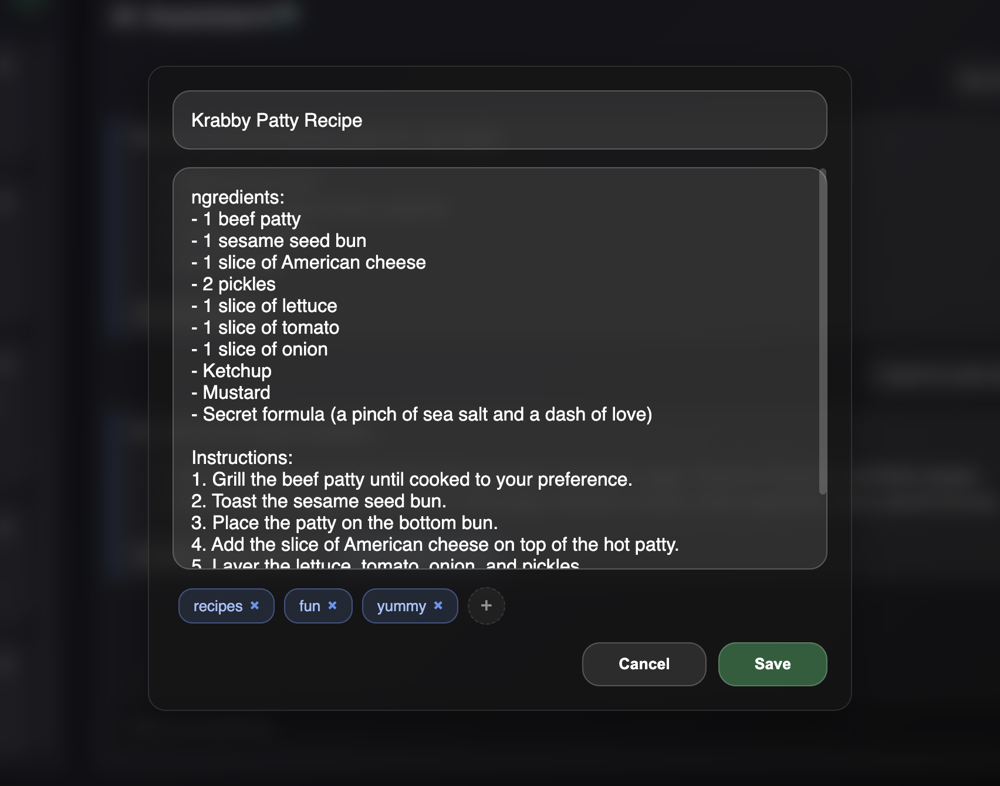

# AI Second Brain

Personal notes app with a chat assistant grounded in **your** notes via RAG (Retrieval-Augmented Generation): Gemini embeddings, PostgreSQL + `pgvector`, and an Express/TypeScript API.

## Live Demo

👉 [Open AI Second Brain](https://ai-second-brain-4cv0.onrender.com/)

Hosted on **Render free tier** — the first request after idle can take **~30–60 seconds** (cold start). Prefer email/password or Google sign-in after the service wakes.

## Key Capabilities

- **Semantic retrieval (RAG):** `pgvector` cosine search scoped per user; embeddings from Gemini (`gemini-embedding-001`, 768 dims).
- **Intent + query expansion:** an LLM step decides whether search is needed and rewrites the query before vector search. **This is not HyDE** (Hypothetical Document Embeddings). Real HyDE is explicitly out of scope until after the MVP freeze.
- **Note capture via function calling:** the model can call `saveNote`; the **server** executes it (user id from the session, never from model args).
- **Auth:** email/password + **Google OAuth**; short-lived **access JWT** and **refresh** tokens in **httpOnly** cookies (refresh hashed in DB, rotation + reuse detection).
- **Hardening for a public demo:** Zod validation, centralized errors, rate limits on auth/`/ask`, XSS sanitization (DOMPurify / `textContent`), CI on GitHub Actions.

---

## Showcase

### Video Walkthrough

https://github.com/user-attachments/assets/51ce94e2-e0f7-4a91-935d-01f7b144f59e

*A demonstration of the AI assistant creating and retrieving notes during a natural dialogue.*

### Screenshot Gallery

| Main Dashboard | Note Editor |
|---|---|
|  |  |

---

## Tech Stack & Architecture

### Technologies

- **Backend:** Node.js, Express 5, TypeScript (ESM), `tsx` in development
- **Frontend:** Vanilla JS / HTML / CSS in `public/`
- **Database:** PostgreSQL + `pgvector` (local Docker Compose; production **Neon**)
- **ORM:** Prisma 7
- **AI:** Google Gemini via `@google/genai` — chat `gemini-3.5-flash-lite`, embeddings `gemini-embedding-001` (see [ADR 001](docs/adr/001-gemini-models.md))
- **Auth:** JWT (HS256) + bcryptjs; Google OAuth (`google-auth-library`); cookies via `cookie-parser`
- **Ops:** pino logging + request IDs, `GET /health`, Vitest + Supertest, GitHub Actions CI

### Layered layout

```
browser → routes → controllers → services → Prisma / Gemini
                 ↘ middleware (auth, rate limit)
```

- **Controllers** — HTTP only (parse, status, cookies/redirects).
- **Services** — business logic (`AskService` orchestrates `/ask`; auth/oauth/notes/AI have no `req`/`res`).
- **Middleware** — JWT from access cookie, rate limits, errors.

Architecture notes: [ADR 002](docs/adr/002-google-account-linking.md) (Google ↔ password account), [ADR 003](docs/adr/003-refresh-tokens-vs-sessions.md) (access/refresh vs sessions).

---

## Security (short)

| Topic | Approach |
|---|---|
| Passwords | bcrypt; same error for unknown email / wrong password |
| Tokens | httpOnly cookies; access ~15m; refresh hashed + rotatable |
| XSS | DOMPurify after `marked` for AI HTML; note UI via `textContent` |
| Abuse | rate limit on `/auth/*` and `/ask` |
| Config | Zod-validated env at startup (fail fast); secrets not in git |

---

## Getting Started

### Prerequisites

- Node.js 18+
- Docker (recommended) for local Postgres + pgvector, **or** any Postgres with `vector`
- Gemini API key
- Optional: Google OAuth client for “Continue with Google”

### Local setup

1. **Clone**
   ```bash
   git clone https://github.com/NKaltia/AI_Second_Brain.git
   cd AI_Second_Brain
   ```

2. **Install**
   ```bash
   npm install
   ```

3. **Database**
   ```bash
   docker compose up -d
   ```
   Copy `.env.example` → `.env` and fill secrets. Local `DATABASE_URL` should point at Docker, **not** production Neon.

4. **Migrate + generate**
   ```bash
   npx prisma migrate deploy
   npx prisma generate
   ```

5. **Run**
   ```bash
   npm run dev
   ```
   App: [http://localhost:3000](http://localhost:3000)

### Useful commands

| Command | Purpose |
|---|---|
| `npm run dev` | Dev server with reload |
| `npx tsc --noEmit` | Typecheck |
| `npm test` | Vitest HTTP tests (needs local DB) |
| `npx prisma migrate dev --name <name>` | New migration (dev only) |

---

## Deployment

- **Render** — build runs `prisma generate`, `prisma migrate deploy`, `tsc`; start `npm start`.
- **Neon** — production database (`DATABASE_URL` in Render env).
- Set `APP_BASE_URL` to the public HTTPS origin and register  
  `{APP_BASE_URL}/auth/google/callback` in Google Cloud OAuth clients.
- Prefer **Auto-Deploy: After CI Checks Pass** so a red GitHub Actions run does not ship.

---

## Contact

Developed by [Nikita Kaltia](https://github.com/NKaltia)
